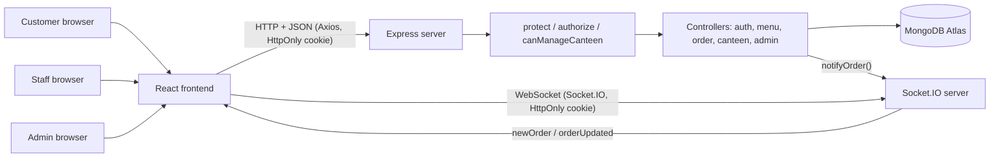
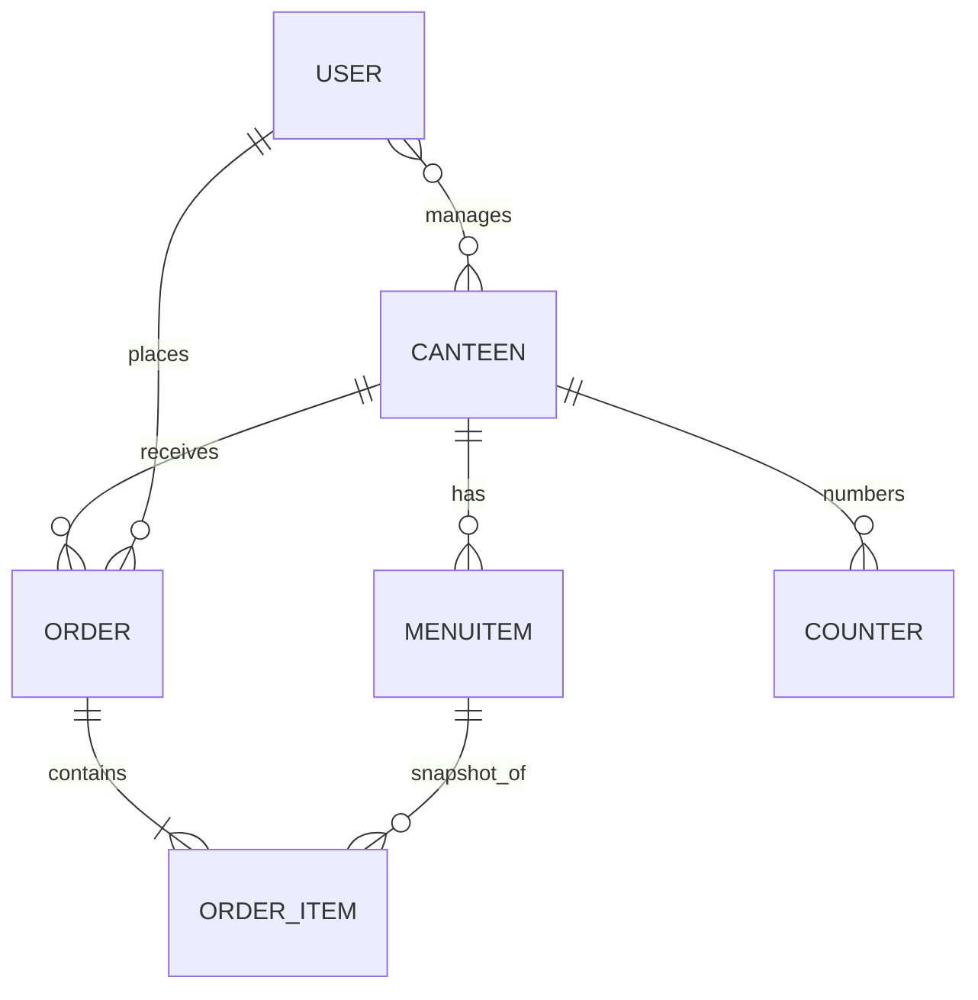
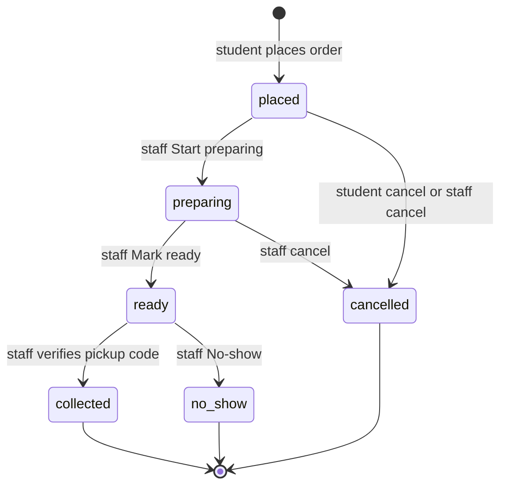

# canteen-management-system
Full-stack Canteen Management System using React, Node.js, Express and MongoDB
# CampusBites – College Canteen Pre-Order Platform

> Order from your campus canteen before you reach it. Skip the queue, collect at the counter, pay at the counter.

A MERN-stack (MongoDB, Express, React, Node.js) web app for **BBDU**, like a small "Swiggy inside the college" but **with no delivery** and **no online payment**. Students and teachers pick a canteen, choose food, choose a pickup time, then collect the food and pay cash or UPI at the counter.

**Status:** the owner reports that the finished multi-canteen application is deployed on Vercel and working. This repository does not independently verify the live site, Vercel environment settings, external no-show scheduler, real-device behavior, or a canteen pilot. `main` is the deployed product branch; start future feature work on a separate branch and keep production changes deliberate.

---

## Table of Contents

1. [Introduction](#1-introduction)
2. [Objectives](#2-objectives)
3. [Problem and Solution](#3-problem-and-solution)
4. [How to Use the Website](#4-how-to-use-the-website)
5. [Features in Detail](#5-features-in-detail)
6. [User Roles and Permissions](#6-user-roles-and-permissions)
7. [Technology Stack](#7-technology-stack)
8. [System Architecture](#8-system-architecture)
9. [Frontend](#9-frontend)
10. [Backend](#10-backend)
11. [Database](#11-database)
12. [Order Lifecycle](#12-order-lifecycle)
13. [API Reference](#13-api-reference)
14. [Live Updates: Socket.IO and Polling](#14-live-updates-socketio-and-polling)
15. [Authentication and Security](#15-authentication-and-security)
16. [Payments](#16-payments)
17. [Installation and Local Setup](#17-installation-and-local-setup)
18. [Environment Variables](#18-environment-variables)
19. [Folder Structure](#19-folder-structure)
20. [Testing and Debugging](#20-testing-and-debugging)
21. [Deployment](#21-deployment)
22. [Limitations and Roadmap](#22-limitations-and-roadmap)
23. [Glossary](#23-glossary)
24. [End-to-End Example](#24-end-to-end-example)
25. [Summary, Contributing, License](#25-summary-contributing-license)
[Screenshots](#screenshots)

---

## 1. Introduction

**The problem.** At a college canteen, everyone arrives at the same time (lunch break). Students stand in a long line, shout orders, the staff forget or mix up orders, and half the break is wasted.

**The idea.** Let people order from their phone *before* they arrive. The canteen sees the order on a screen, prepares it, and marks it ready. The student walks in, shows a 4-digit code, takes the food, and pays at the counter.

**Who uses it**
- **Students and teachers** – order food.
- **Canteen staff** – see and prepare orders on a dashboard.
- **Admin (the developer/college)** – creates canteens and staff logins and can view everything.

**Why better than the counter:** no shouting, no lost orders, prices always correct (the server calculates them), a pickup code prevents someone else taking your food, and each canteen only sees its own orders.

---

## 2. Objectives

| Objective | Status |
|---|---|
| Let students order food before arriving | Implemented |
| Support multiple canteens, each with its own menu and orders | Implemented |
| Let staff manage orders (prepare, ready, collect, cancel, no-show) | Implemented |
| Let customers see order status | Implemented (30s polling on Vercel; Socket.IO is available on long-running hosts) |
| Pickup verification with a 4-digit code | Implemented |
| Cash/UPI payment confirmed manually at the counter | Implemented |
| Open/closed switch, pickup-slot limits, no-show auto-blocking after one missed pickup | Implemented in code |
| Order history, reorder, search, sales reports, admin controls, editable account profile/password, PWA manifest | Implemented in code |
| Docker development and GitHub Actions CI | Configured; local Docker startup not yet verified |
| Real-device testing and CampusBites pilot | Not done |
| Production deployment | Owner reports deployed on Vercel; live settings and production checks remain unverified here |

---

## 3. Problem and Solution

**Old way:** Riya reaches the canteen at 1:00 PM. 40 people are ahead of her. She waits 20 minutes, orders a sandwich, waits 10 more. Her break is over. The staff wrote 15 orders on paper and two got mixed up.

**New way:** At 12:40 Riya opens the app in class, picks the canteen, adds a sandwich, chooses pickup 1:00 PM. The canteen screen beeps with her order. When it is marked Ready, Riya's phone shows the status and her 4-digit code. She walks to the counter, shows the code, pays, and collects it.

---

## 4. How to Use the Website

### As a student or teacher
1. Open the site and **Register** (name, email, phone, password; new registrations get the student role), then **Login**. Teacher accounts must already be provisioned; registration does not let a user choose a role.
2. The home page lists the **active canteens**. Tap one.
3. On the canteen menu, press **+** on items to add them to the cart. (One cart can only hold items from **one canteen**. If you add from another canteen you are asked whether to switch.)
4. Open **Cart**, choose a **pickup time**, and place the order. You can only have **one active order** at a time.
5. Go to **My Orders**. You see your order number (like `A7`), its status, and your **4-digit pickup code** while the order is active.
6. You can **cancel** your own order only while its status is "placed".
7. When status becomes **Ready**, go to the counter, tell the staff the code, and pay cash/UPI.
8. A ready order not collected within the allowed time is marked no-show and blocks the account. Pay the full no-show order amount at that canteen's counter; staff record the payment and unblock the account.
9. Optionally press **Enable notifications** on My Orders so the browser can alert you when the order is ready.

### As canteen staff
1. Login with the account the admin created for your canteen.
2. Open **Dashboard**. Press **Enable sound** once (browsers block sound until you click), so new orders beep.
3. New orders appear automatically. Press **Start preparing**, then **Mark ready**.
4. When the student arrives, type their **pickup code**, keep **Payment received** ticked if they paid, and press **Collect**.
5. If a collected order was not paid yet, press **Confirm payment** later.
6. Use **Cancel** (placed/preparing orders) or **No-show** (ready orders) when needed. The first no-show blocks the student immediately.
7. Open **Manage Menu** to add, edit, delete items, mark items sold out, and set today's special.
8. Open **Blocked** to record payment received at the counter for each no-show order, then unblock the student.
9. Open **Sales Report** for order/payment totals, best sellers, and busy pickup hours.

### As admin
1. Login with your admin account (made with `makeAdmin.js`).
2. Open **/admin** to create/edit canteens, assign staff, view blocked accounts, reset a canteen owner's password, and manage canteen availability.
3. Use staff pages to view all canteens and reports; admin access is checked by the server.

---

## 5. Features in Detail

### A. Customer features
| Feature | What happens behind the scenes | Where |
|---|---|---|
| Register / login | Password hashed with bcrypt; the signed JWT is set in an HttpOnly cookie | `authController`, `Login.jsx`, `Register.jsx`, `AuthContext.jsx` |
| Browse canteens | `GET /api/canteens` returns only active canteens | `CanteenList.jsx` |
| Browse a canteen menu | `GET /api/canteens/:id/menu` returns canteen and items | `CanteenMenu.jsx` |
| Cart for one canteen | Cart saved in browser (`localStorage` keys `cart`, `cartCanteen`); switching canteen prompts | `CartContext.jsx`, `Cart.jsx` |
| Place order | Server re-reads prices from the DB, creates order and pickup code | `orderController.createOrder` |
| Order number | `A1, A2...` per canteen per day (India time), using an atomic counter | `nextOrderNumber`, `Counter` model |
| See pickup code | Returned only for active orders and only to the owner | `getMyOrders`, `MyOrders.jsx` |
| Cancel order | Allowed only for the owner and only while `placed` | `cancelOrder` |
| Live status | Socket event triggers a refetch; 30s polling backup | `MyOrders.jsx` |
| Ready notification | Browser `Notification` API when status becomes `ready` and permission is granted | `MyOrders.jsx` |
| Order history and reorder | Shows past orders; re-fetches current menu/prices and skips unavailable items | `MyOrders.jsx` |
| Search, categories, images, popular/special labels | Menu image URL, name search, category chips, top-three popular items, staff-set special | `CanteenMenu.jsx` |
| Rush and estimated wait | Based on current placed/preparing order count and canteen prep estimate | `canteenController` |
| Pickup time and note | Choose from 12 upcoming 10-minute slots; optional note up to 100 characters | `Cart.jsx`, `createOrder` |

### B. Staff features
| Feature | Where |
|---|---|
| See active orders of own canteen(s) (plus collected-but-unpaid) | `getActiveOrders`, `Dashboard.jsx` |
| Live new-order push with beep | `Dashboard.jsx`, `sound.js`, `socket.js` |
| Move order: placed → preparing → ready | `updateStatus` |
| Verify pickup code and collect | `verifyAndCollect` |
| Confirm payment separately | `confirmPayment` |
| Cancel (placed/preparing) or mark no-show (ready) | `updateStatus` |
| Call the student (phone link on card) | `Dashboard.jsx` |
| Manage menu (add/edit/delete/availability) | `ManageMenu.jsx`, `menuController` |
| Switch canteens (only if managing more than one) | `CanteenSwitcher.jsx`, `useStaffCanteen.js` |
| Open/close canteen | Staff/admin endpoint with canteen ownership check | `setOpen` |
| Review blocked students, record no-show payment, unblock | Payment must be recorded before staff unblock | `BlockedStudents.jsx` |
| Sales report | Today/7/30-day totals, paid/unpaid amounts, top items, pickup hours | `SalesReport.jsx` |

### C. Admin features
| Feature | Where |
|---|---|
| Become admin via script | `server/makeAdmin.js` |
| Create canteens (`POST /api/canteens`), edit (`PATCH`) | `canteenController`, `AdminPanel.jsx` |
| Create staff login for canteen(s) | `POST /api/admin/staff` |
| Change which canteens a staff user manages | `PATCH /api/admin/users/:id/canteens` |
| View/edit canteens and owners; unblock paid students | Admin overview and canteen/user endpoints |
| Reset any account password after verifying identity | Admin panel reset form |
| View sales report | Same report page/API with admin access to all canteens |
| View/manage every canteen | `canManageCanteen` returns true for admin |

### D. Data and safety features
- Server recalculates prices; order items store **snapshots** (name, price) so later menu changes do not alter old orders.
- First no-show blocks immediately; a blocked student cannot place a new order. Staff must record payment for every unpaid no-show order across all canteens before unblocking.
- No online payment or separate fine is implemented.
- Legacy orders without pickup codes can still be collected without a code.

---

## 6. User Roles and Permissions

| Role | Can do | Pages | Restrictions |
|---|---|---|---|
| `student` / `teacher` | Browse, order, view/reorder own orders, edit profile, change password | `/`, `/canteen/:id`, `/cart`, `/orders`, `/account` | Cannot open staff/admin pages; one active order at a time; blocked after first no-show |
| `canteen` (staff) | Manage orders/menu for assigned canteens; update open state; review blocked users and sales | plus `/dashboard`, `/manage-menu`, `/blocked`, `/report` | Other canteens return 403; no `/admin` |
| `admin` | Manage all canteens, staff, blocked accounts, owner resets and reports | plus `/admin`, staff pages | High privilege; protect the account |

**Authentication** = checking *who you are* (login, JWT). **Authorization** = checking *what you may do* (roles and canteen ownership).

- Authentication: `protect` reads the HttpOnly auth cookie, verifies it, and reloads the user on every request so current roles and canteen ownership are checked.
- Authorization: `authorize(...roles)` checks the role; `canManageCanteen(user, canteenId)` is `true` for admin, and for staff only if the canteen is in their `managedCanteens`.
- Registration **never** sets a role. Only `makeAdmin.js` (run by the developer) or `POST /api/admin/staff` (admin) can create privileged accounts.

---

## 7. Technology Stack

| Technology | What it is | Where/why in this project |
|---|---|---|
| **React** (Vite, JSX) | UI library | All pages and components in `client/src` |
| **react-router-dom** | Page routing | Routes like `/dashboard`; `ProtectedRoute` guards them |
| **Axios** | HTTP client | `client/src/api.js` uses `VITE_API_URL` when configured, otherwise same-origin `/api`, and sends the HttpOnly-cookie session |
| **Plain CSS** | Styling | `client/src/index.css` (classes `card`, `order-card`, `dash-grid`...) |
| **Node.js** | JS runtime | Runs the server |
| **Express** | Web framework | Routes, middleware, JSON API (`server.js`) |
| **MongoDB Atlas (M0)** | Cloud database | Stores users, canteens, menu items, orders, counters |
| **Mongoose** | MongoDB modelling | Schemas/models in `server/models` |
| **jsonwebtoken (JWT)** | Signed login tokens | Payload includes user id, role, and token version |
| **bcryptjs** | Password hashing | Passwords are stored as `passwordHash` |
| **dotenv** | Loads `.env` | Secrets and config |
| **cors** | Cross-origin rules | Allows configured client origins and same-origin requests for Vercel deployments |
| **Socket.IO** (server) and **socket.io-client** | Live two-way messages | Supported on long-running hosts; the Vercel build uses polling |
| **Web Audio API** | Browser sound | The new-order beep in `sound.js` |
| **Notification API** | Browser alerts | "Order ready" alert on My Orders |
| **nodemon** | Auto-restart in dev | `npm run dev` in `server/` |
| **crypto (Node built-in)** | Secure random | `crypto.randomInt` makes pickup codes |

No payment gateway, no Tailwind, and no validation library are used.

---

## 8. System Architecture



Plain-language view:

```text
Student / Staff / Admin browser
        | HTTPS/JSON (Axios)           | Socket.IO (JWT-authenticated)
        v                              v
        Express API  <-------------->  Socket.IO rooms
        | auth + role + canteen ownership checks
        v
   Mongoose models
        |
        v
 MongoDB Atlas (external database)
```

**Two channels, two jobs**
1. **HTTP (request/response):** the browser asks, the server answers once. Used for *all* real data and all changes (login, place order, change status).
2. **Socket.IO (server push):** a small "something changed" message pushed to the right people. The browser then calls HTTP again to fetch the fresh data. No order data or pickup code travels in the socket message.

**Polling** (a timer calling the API every 30s) is enabled in Dashboard and My Orders. It is the live Vercel behavior; Socket.IO is disabled by the Vercel client build.

**What happens when you click "Mark ready":** React calls `api.patch('/orders/:id/status')` → the browser sends its HttpOnly cookie → Express runs `protect` → `authorize` → `updateStatus` checks ownership and allowed transition → saves to MongoDB → calls `notifyOrder` (socket push) → returns JSON → Dashboard reloads the list.

---

## 9. Frontend

**What it is:** the part running in the browser (React). It shows pages and talks to the server.

### Key files
| File | Responsibility |
|---|---|
| `App.jsx` | Route table, wraps pages in providers/layout |
| `api.js` | Axios instance (uses same-origin `/api` in production; local Vite development may use `VITE_API_URL`; sends credentials for the HttpOnly auth cookie) and `errorMessage(err)` helper |
| `socket.js` | `connectSocket()` (reuses one cookie-authenticated connection), `disconnectSocket()`. Vercel builds disable Socket.IO and use polling; other builds use same-origin unless local `VITE_API_URL` is set |
| `sound.js` | `enableSound()` (must be called from a click; resumes the AudioContext) and `beep()` (880 Hz tone, 0.5 s) |
| `useStaffCanteen.js` | Hook: loads the canteens a staff user may manage (admin: all), remembers the selected `canteenId` |
| `context/AuthContext.jsx` | Holds `user`, `loading`, `login`, `register`, `logout`; restores session through `/auth/me` using the HttpOnly cookie; closes the socket when `user` becomes empty |
| `context/CartContext.jsx` | Cart items, the single cart canteen, `addItem(menuItem, canteen)`, saved in `localStorage` |
| `components/Layout.jsx`, `Navbar.jsx` | Page frame and navigation |
| `components/ProtectedRoute.jsx` | Redirects if not logged in / wrong role |
| `components/CanteenSwitcher.jsx` | Dropdown for staff/admin with several canteens |

### Pages
| Page | Route | What it does |
|---|---|---|
| `Login.jsx`, `Register.jsx` | `/login`, `/register` | Auth forms |
| `CanteenList.jsx` | `/` | Lists active canteens |
| `CanteenMenu.jsx` | `/canteen/:id` | Menu and add-to-cart |
| `Cart.jsx` | `/cart` | Shows "Ordering from X", pickup slots and note; closed canteens are blocked in UI and server |
| `MyOrders.jsx` | `/orders` | Current and past orders, pickup code, cancel, reorder, late notice, live updates |
| `AccountSettings.jsx` | `/account` | View/edit profile details and change the signed-in user's password |
| `Dashboard.jsx` | `/dashboard` | Staff order board |
| `ManageMenu.jsx` | `/manage-menu` | Staff menu editor |
| `BlockedStudents.jsx` | `/blocked` | Record no-show order payments and unblock users |
| `SalesReport.jsx` | `/report` | Per-canteen sales/activity report |
| `AdminPanel.jsx` | `/admin` | Canteen, staff-owner, and blocked-account administration |

The older `Menu.jsx` file is not connected to the current route table.

### React concepts as used here
- `useState` keeps data that changes (orders list, typed codes, `soundOn`).
- `useEffect` runs side effects: load data, start/stop timers, join/leave socket rooms (with cleanup functions).
- `useCallback` keeps `load` stable so effects do not re-run needlessly (Dashboard's `load` depends on `canteenId`).

### Dashboard functions (`Dashboard.jsx`)
- `load()` – `GET /orders?canteen=<id>` then `setOrders`; clears errors; sets `loading` false.
- Polling effect – resets the list, calls `load()`, then `setInterval(load, 30000)`; the timer is cleared on unmount or when the canteen changes.
- Socket effect – connects, joins `canteen:<id>`, rejoins after reconnect, on `newOrder` reloads and beeps, on `orderUpdated` reloads; on cleanup leaves the room and removes listeners (so switching canteens leaves the old room and joins the new one).
- `run(order, request)` – shared wrapper: disables buttons for that order, runs the request, reloads, shows errors.
- `setStatus(order, status, confirmText)` – asks for confirmation if given, then `PATCH /orders/:id/status`.
- `collect(order)` – requires a typed code, sends `PATCH /orders/:id/verify` with `{code, paid}` (`paid` is true unless the checkbox was unticked), then clears the typed code.
- `confirmPayment(order)` – `PATCH /orders/:id/payment`.

### My Orders functions (`MyOrders.jsx`)
- `load()` – `GET /orders/my`; active orders are those in placed/preparing/ready, the rest are past.
- Polling effect – every 30s (as edited in Day 11).
- Socket effect – on `orderUpdated`: reload, and if status is `ready` and notification permission is granted, show a browser notification.
- `cancel(id)` – confirm dialog, then `PATCH /orders/:id/cancel`.
- `OrderCard` – shows number, status pill, canteen name, pickup code box (active orders only).

---

## 10. Backend

**What it is:** the server that holds the rules and the database connection. Browsers can be tampered with, so *every* rule is enforced here.

**Startup (`server.js`):** loads `.env`, checks required environment variable names, configures Helmet, CORS and allowed-Origin checks, and limits JSON bodies to 100 KB. It registers routes and safe error handling, connects to MongoDB, then creates the HTTP server, attaches cookie-authenticated Socket.IO, and listens on `PORT` (default 5001).

### Backend files
| File | Purpose |
|---|---|
| `server.js` | App setup, routes, DB connect, HTTP + Socket.IO start |
| `socket.js` | `initSocket`, `emitToUser`, `emitToCanteen`, `notifyOrder` |
| `middleware/auth.js` | `protect`, `authorize(...roles)`, `canManageCanteen(user, canteenId)` |
| `slots.js` | Ten-minute slot boundaries and active-order count |
| `noShow.js` | Shared manual/automatic no-show rule and cron schedule |
| `models/` | `User`, `Canteen`, `MenuItem`, `Order`, `Counter` |
| `controllers/` | `auth`, `menu`, `order`, `canteen`, `admin` |
| `routes/` | `authRoutes`, `menuRoutes`, `orderRoutes`, `canteenRoutes`, `adminRoutes` |
| `seed.js` | Adds sample canteens and menus; **deletes and replaces menu items for those sample canteens** |
| `migrate-multi-canteen.js` | Attaches legacy unassigned records to CampusBites and copies counters |
| `makeAdmin.js` | Promotes an already-registered account to admin |
| `makeCanteen.js` | Legacy role helper; use admin staff creation/assignment instead |
| `test/` | Node built-in backend tests |

### `orderController.js` functions (verified)
| Function | What it does |
|---|---|
| `todayKey()` | Today's date in `Asia/Kolkata` so order numbers reset at midnight IST |
| `makePickupCode()` | 4-digit zero-padded code via `crypto.randomInt` |
| `publicOrder(order)` | Removes `pickupCode` and `codeAttempts` before sending to staff |
| `nextOrderNumber(canteenId)` | Atomic `findOneAndUpdate $inc` on `Counter` → `A<seq>` |
| `createOrder` | Checks: user not blocked; valid note/time/items; quantities 1-20; no active order; items exist, available, from one canteen; canteen active/open; slot has room; recalculates prices from MongoDB; saves and emits `newOrder` |
| `getMyOrders` | User's orders, newest first, canteen name populated; pickup code kept only for active orders |
| `getActiveOrders` | Staff: own canteens; admin: all or `?canteen=`; returns active orders plus collected-and-unpaid; no pickup code |
| `updateStatus` | Validates status and ownership; allowed moves only (see lifecycle); sets `readyAt` when ready; emits `orderUpdated`; rejects `collected` |
| `cancelOrder` | Owner only, only while `placed` |
| `verifyAndCollect` | Order must be `ready`; checks code (max 5 wrong tries then 429); sets `collected`; sets `paid` only if `paid === true`; emits |
| `confirmPayment` | For `ready`, `collected`, or `no_show` orders → `paymentStatus: "paid"`; emits |
| `getSalesReport` | Validates canteen access and period; reports payments, unpaid amounts, no-shows, best sellers, pickup hours |
| `markNoShow` | Atomically changes a ready order to no-show; increments the user count and blocks at the first no-show |

### `socket.js` functions (verified)
- `initSocket(server)` – creates the Socket.IO server with credentialed CORS from `CLIENT_URL`. A middleware verifies the HttpOnly-cookie JWT and current token version, loads the user from the DB, and rejects invalid sessions. On connect, the socket joins `user:<id>`. `joinCanteen` validates the id and `canManageCanteen`; `leaveCanteen` leaves the room.
- `emitToUser`, `emitToCanteen` – send an event to a room.
- `notifyOrder(order, event)` – sends `{orderId, orderNumber, status, paymentStatus, canteenId}` (never the pickup code). `newOrder` goes only to the canteen room; `orderUpdated` goes to the canteen room and the student's room.

---

## 11. Database

**MongoDB** stores data as *documents* (JSON-like) inside *collections* (like tables). **Mongoose** gives each collection a *schema* (allowed fields) and a *model* (the code object used to read/write). An **ObjectId** is the unique `_id` of a document. A **reference** stores another document's `_id`; **populate** swaps it for the real data when reading.

### Models
| Model | Stores | Fields |
|---|---|---|
| `Canteen` | A canteen | `name`, unique `slug`, `logo`, `description`, `location`, `isOpen`, `isActive`, `slotLimit`, `avgPrepMins`, `createdAt` |
| `User` | Accounts | `name`, unique `email`, `phone`, optional `rollNumber`, `department`, `year`, `avatarUrl`, hidden `passwordHash`/`tokenVersion`, `role`, `managedCanteens`, `noShowCount`, `isBlocked`, `blockedAt`, `createdAt` |
| `MenuItem` | Food items | `canteen`, `name`, `price`, `category`, image URL, `isAvailable`, `isSpecial`, `prepTimeMins` |
| `Order` | Orders | `canteen`, per-canteen `orderNumber`, `user`, item price/name snapshots, `total`, `pickupTime`, `status`, separate `paymentStatus`, hidden `pickupCode`/`codeAttempts`, `createdAt`, `readyAt`, `lateExtended`, `note` |
| `Counter` | Order-number counter | `_id` = `"<canteenId>:<YYYY-MM-DD>"`, `seq` |



### Example order document (fictional)
```json
{
  "_id": "665f0c1e2a9b4c0012ab34cd",
  "canteen": "665f0a112a9b4c0012ab0001",
  "orderNumber": "A7",
  "user": "665f0b772a9b4c0012ab0099",
  "items": [{ "menuItem": "665f0b002a9b4c0012ab0050", "name": "Veg Sandwich", "price": 40, "qty": 2 }],
  "total": 80,
  "pickupTime": "2026-10-30T07:30:00.000Z",
  "status": "placed",
  "paymentStatus": "pending"
}
```
(`pickupCode` is stored but never shown in normal staff responses.)

### What happens in the database
| Action | Reads | Writes |
|---|---|---|
| Register/login | Look up user by email | Register creates a `User` with hashed password |
| Place order | Active order check, menu items, canteen | `Counter` increment, new `Order` |
| Status change | The order | `status` (and `readyAt`) updated |
| Verify code | Order with `+pickupCode +codeAttempts` | `codeAttempts` on a wrong code; `status` (and maybe `paymentStatus`) on success |
| Confirm payment | The order | `paymentStatus = "paid"` |

---

## 12. Order Lifecycle



1. Student picks a canteen and items (cart stays with one canteen).
2. Student chooses a pickup time and presses order → `POST /api/orders`.
3. Server validates, recalculates prices, creates `A<n>` and a 4-digit code, saves, pushes `newOrder` to the canteen room.
4. Staff dashboard reloads and beeps.
5. Staff: **Start preparing** → `preparing`; **Mark ready** → `ready` (`readyAt` saved). Student gets a push and a browser notification (if allowed).
6. Student shows the code. Staff enters it → `PATCH /orders/:id/verify` → `collected`.
7. Payment: either ticked during Collect, or later through **Confirm payment**.

| Transition | Route / function |
|---|---|
| placed → preparing / cancelled, preparing → ready / cancelled, ready → no_show | `PATCH /orders/:id/status` → `updateStatus` |
| placed → cancelled (student) | `PATCH /orders/:id/cancel` → `cancelOrder` |
| ready → collected | `PATCH /orders/:id/verify` → `verifyAndCollect` |
| ready → no_show | `PATCH /orders/:id/status` → `markNoShow`; first no-show blocks the account |
| record payment for a no-show order | `PATCH /orders/:id/payment`; staff must record the full order amount at the counter before unblocking |

**Status vs payment:** `status` says where the food is in the process; `paymentStatus` says whether money was received. They are independent. Collecting never marks paid automatically; staff must tick the box or confirm payment. A no-show is an exception to the usual collection: the student is blocked immediately and can be unblocked by staff only after the full order amount is paid in person and recorded.

The automatic no-show check runs every minute and marks an order after it has been ready for 20 minutes (30 minutes after the student uses the one-time late extension). Staff can also manually mark an order while it is ready. Both paths use the same `markNoShow` operation; the ready-only database update prevents the same order being counted twice. The first no-show blocks the account. Staff record the full order total as paid at the counter for each no-show order before unblocking; no separate fine or online payment exists.

**Pickup slots:** the client displays the next 12 ten-minute slots. The server checks active orders and creates a new order in a MongoDB transaction after writing to the user and canteen lock documents. This serializes competing submissions for the same user/canteen; verify transaction behavior against the actual Atlas deployment.

**Multi-canteen rules:** each menu item and order belongs to a canteen; staff access is checked against `managedCanteens` on protected actions. A cart contains one canteen only. The server identifies that canteen from the requested menu items and recalculates all prices from MongoDB, rather than trusting browser-sent prices.

---

## 13. API Reference

All responses are JSON. Errors look like `{ "message": "..." }`. Protected browser requests use the HttpOnly auth cookie; unsafe methods require an allowed `Origin` from `CLIENT_URL`.

| Method | Endpoint | Purpose | Who can call it |
|---|---|---|---|
| GET | `/api/health` | API and MongoDB connection health | Public |
| GET | `/api/internal/no-show` | Run the overdue no-show check | Trusted scheduler only; requires `CRON_SECRET` |
| POST | `/api/auth/register` | Register an account; new registrations get the student role | Public |
| POST | `/api/auth/login` | Sign in | Public |
| POST | `/api/auth/logout` | Clear the auth cookie | Public, Origin-checked |
| GET | `/api/auth/me` | Current user profile/block state | Logged-in user |
| PATCH | `/api/auth/me` | Edit own name, email, phone, and optional profile details | Logged-in user; current password required to change email |
| PATCH | `/api/auth/password` | Change own password | Logged-in user |
| PATCH | `/api/admin/users/password` | Reset an account password after offline identity verification | Admin |
| GET | `/api/canteens` | Active canteens with rush/wait estimate | Public |
| GET | `/api/canteens/:id` | Read active canteen | Public |
| GET | `/api/canteens/:id/menu` | Menu, Popular tags, rush/wait estimate | Public |
| GET | `/api/canteens/:id/slots` | Next 12 pickup slots and capacity | Public |
| POST | `/api/canteens` | Create canteen | Admin |
| PATCH | `/api/canteens/:id` | Edit canteen fields/active state | Admin |
| PATCH | `/api/canteens/:id/open` | Open or close a canteen | Assigned staff/admin |
| GET | `/api/canteens/:id/blocked` | Blocked users with no-show orders at the canteen | Assigned staff/admin |
| PATCH | `/api/canteens/:id/unblock/:userId` | Unblock after all of the user's unpaid no-show orders are paid | Assigned staff/admin |
| GET | `/api/menu?canteen=<id>` | Read menu items; canteen filter optional | Public |
| POST | `/api/menu` | Create menu item | Assigned staff/admin |
| PATCH | `/api/menu/:id` | Edit item fields/availability/special flag | Assigned staff/admin |
| DELETE | `/api/menu/:id` | Delete item | Assigned staff/admin |
| POST | `/api/orders` | Place order; server recalculates menu prices | Logged-in, unblocked user |
| GET | `/api/orders/my` | Own history; pickup code only on active orders | Logged-in user |
| GET | `/api/orders` (optional `?canteen=<id>` for admin) | Active and collected-but-unpaid orders | Assigned staff/admin; staff can request only assigned canteens |
| GET | `/api/orders/report?canteen=<id>&days=1\|7\|30` | Sales/payment/no-show report | Assigned staff/admin |
| PATCH | `/api/orders/:id/status` | Prepare, mark ready, or manually mark no-show | Assigned staff/admin |
| PATCH | `/api/orders/:id/cancel` | Cancel own placed order | Order owner |
| PATCH | `/api/orders/:id/late` | One 10-minute extension while ready | Order owner |
| PATCH | `/api/orders/:id/verify` | Verify pickup code and collect | Assigned staff/admin |
| PATCH | `/api/orders/:id/payment` | Record counter payment, including no-show payment | Assigned staff/admin |
| GET | `/api/admin/overview` | Canteens, owners, blocked students/teachers | Admin |
| POST | `/api/admin/staff` | Create staff account and assign canteens | Admin |
| PATCH | `/api/admin/users/:id/canteens` | Change staff canteen assignments | Admin |
| PATCH | `/api/admin/users/:id/unblock` | Admin unblock after no-show orders are paid | Admin |
| PATCH | `/api/admin/users/:id/password` | Reset a canteen owner's password | Admin |

`Assigned staff` means a canteen-role user whose `managedCanteens` includes the target canteen. Admin can manage every canteen. No route accepts or processes online payments.

**Common errors:** 400 invalid input/transition, 401 missing or invalid login, 403 forbidden/blocked user, 404 not found, 409 conflict (including a full slot or active order), and 429 when a caller tries again after using all five pickup-code attempts.

Forgot-password recovery is admin-assisted; no email or SMS reset is configured. The admin must verify the user's identity outside the app, set a temporary password in the Admin page, and share it securely. The user can then sign in and change it in Account settings. Do not send passwords in chat.

**Example: place an order (fictional)**
Use a cookie jar populated by a successful login request.
```bash
curl -X POST http://localhost:5001/api/orders \
  -b cookiejar -c cookiejar \
  -H "Origin: http://localhost:5173" \
  -H "Content-Type: application/json" \
  -d '{"items":[{"menuItemId":"665f0b002a9b4c0012ab0050","qty":2}],"pickupTime":"2026-10-30T07:30:00.000Z"}'
```
Response `201`: the order document (including `orderNumber`, `total`, `status: "placed"`).

---

## 14. Live Updates: Socket.IO and Polling

**Socket.IO** keeps an open connection so the server can push messages instantly. **Polling** means asking the server again and again on a timer.

**Actually implemented**
- Client: `connectSocket()` uses the HttpOnly auth cookie; `disconnectSocket()` runs when the user becomes empty (logout).
- Server verifies the JWT on connection. Each user joins `user:<id>`. Staff/admin ask to join `canteen:<id>` with `joinCanteen`; the server checks `canManageCanteen`.
- Events (small payloads, no pickup code):

| Event | Sent to | When |
|---|---|---|
| `newOrder` | `canteen:<id>` | `createOrder` |
| `orderUpdated` | `canteen:<id>` and `user:<id>` | `updateStatus`, `cancelOrder`, `verifyAndCollect` (success), `confirmPayment` |

- The Dashboard listens for both, compares `payload.canteenId` with the selected canteen, then calls `load()`. `newOrder` also calls `beep()` (works after "Enable sound" was clicked).
- The Dashboard rejoins on `connect` after a drop. Switching canteen runs the effect cleanup: `leaveCanteen` for the old, `joinCanteen` for the new.
- My Orders listens for `orderUpdated`, reloads, and shows a browser notification when `ready`.
- **Polling fallback:** Dashboard and My Orders call `load` every **30 seconds** (`setInterval`, cleared on unmount/canteen change).

**Why both?** Sockets can drop (phone sleeps, bad Wi-Fi); polling guarantees the screen eventually catches up.

**Vercel:** the client disables Socket.IO because the server is a function, and relies on the existing 30-second polling. A trusted external scheduler must call `GET /api/internal/no-show` every minute with `CRON_SECRET`; Vercel Hobby Cron is limited to once per day and is not frequent enough for the current no-show rule.

**Limitation:** a PWA manifest/icon exists, but there is no service worker; mobile install/notification behavior still needs device testing.

---

## 15. Authentication and Security

**Current implementation**
- Passwords hashed with `bcryptjs`; `passwordHash` is `select: false` and never returned.
- JWT with payload containing user id, role, and token version, stored in an HttpOnly cookie; user reloaded from DB on every request. Password changes/resets increment the version and invalidate older sessions.
- Unsafe browser methods require an allowed `Origin`; CORS allows credentials for configured client and Vercel same-origin requests.
- Role checks (`authorize`) and per-canteen checks (`canManageCanteen`) on staff endpoints.
- Ids validated with `mongoose.isValidObjectId`.
- Prices computed by the server; each item quantity and merged duplicate quantity are limited to 1-20, with at most 20 submitted item lines.
- Pickup code: secure random, hidden from staff and from non-active orders, 5 wrong attempts then 429.
- Socket connections require a valid cookie JWT; room joins are ownership-checked.
- CORS allows configured `CLIENT_URL` origins plus supported Vercel/same-origin requests; Socket.IO uses configured origins on long-running hosts.
- JSON request bodies are capped at 100 KB; production 5xx responses hide internal messages, and logs omit error details.
- Passwords are hashed; registration requires name, email, phone, and a password of at least six characters. Registration always creates the default student role.
- Secrets are read from environment variables; never commit local `.env` files.

**Not implemented:** rate limits beyond login/register and pickup verification, broader schema-level request validation, and automated database-backed authorization tests. Helmet security headers are enabled. Login is limited to 10 attempts per IP per 15 minutes; registration to 5 per IP per hour; failed pickup-code verification is limited to 30 attempts per staff account per 15 minutes (successful collections do not count). Rate-limit counters use an in-memory store and reset on server restart. Auth uses an HttpOnly cookie and unsafe browser requests are checked against configured origins. If client and API use different Vercel domains, verify cross-site cookie behavior; same-origin routing is preferable. See [the route audit](./docs/SECURITY-ROUTE-AUDIT.md).

---

## 16. Payments

- There is **no online payment and no payment gateway**, by design.
- Customers pay **cash or UPI at the counter**.
- `paymentStatus` is `pending` or `paid`. Staff set it by ticking **Payment received** when collecting, or later with **Confirm payment**.
- The check happens in the backend (`verifyAndCollect`, `confirmPayment`), but the "payment" is just staff recording what happened at the counter.
- After a no-show the full saved order total is owed at the counter; staff record it before unblocking the account. There is no separate fine.

---

## 17. Installation and Local Setup

**Prerequisites:** Node.js 22 (or 20.19+), npm, Git, Docker with the Compose plugin, and access to the existing MongoDB Atlas cluster.

```bash
git clone https://github.com/HarshitCode-02/canteen-management-system.git
cd canteen-management-system
git checkout multi-canteen
```
> If your repo root is a parent folder named `canteen-app`, run the commands below from there. The project has two apps: `server/` and `client/`, each with its own `package.json`.

### Docker development (recommended)

The database remains MongoDB Atlas; Compose does not create, expose, or replace it. Create the backend environment file from the safe template, then put your own Atlas URI and a long random JWT secret in it:

```bash
if [ ! -f server/.env ]; then cp server/.env.example server/.env; fi
# Edit server/.env locally; never commit it.
docker compose up --build
```

Open `http://localhost:5173`. The frontend calls `http://localhost:5001/api` from your browser. The backend container also uses port 5001; its health check only passes when the API responds and Mongoose reports an active database connection. The frontend waits for that health check before starting. Source files are bind-mounted for reload, and dependency volumes keep container-installed packages separate from host `node_modules`.

Useful Compose commands, from the repository root:

```bash
docker compose up --build          # Build images if needed, then start the services.
docker compose down                # Stop and remove containers and the Compose network.
docker compose logs -f              # Follow logs from both services.
docker compose logs -f server       # Follow backend logs only.
docker compose restart server       # Restart one service without rebuilding its image.
docker compose ps                   # See whether services are running or healthy.
```

`restart` does not rebuild images or reload changed Compose settings. After editing a Dockerfile or dependency manifest, use `docker compose up --build` again. `down` does not delete Atlas data.

### Run without Docker

**Backend** (`server/`)

```bash
cd server
npm ci
# Create .env using the variables in the next section.
node seed.js        # optional: sample canteens/menus
npm run dev         # nodemon server.js, expect "MongoDB connected" and "Server running on port 5001"
```
**Important:** `seed.js` deletes and replaces menu items for its four sample canteens on every run. Do not run it against production data or use it to enter CampusBites' real menu. After registering your account, an operator can promote it with `node makeAdmin.js your-email@example.com`; then sign out and back in.

The one-time migration utility is `node migrate-multi-canteen.js`. Back up the database first and inspect the script before running it against any data. It attaches records without a canteen to CampusBites, assigns existing canteen staff to it, and copies old counters.

**Frontend** (`client/`)
```bash
cd client
npm ci
# Optional for local Vite: cp .env.example .env
npm run dev
```
Open the URL Vite prints and check `http://localhost:5001/api/health`.

---

## 18. Environment Variables

The safe templates are `server/.env.example` and `client/.env.example`. Copy the backend template to `server/.env` for local server/Docker use; the client template is for running Vite directly on your host. Compose sets the browser API URL. Never share or commit `.env` files.

| Variable name | Used by |
|---|---|
| `MONGO_URI` | Server; MongoDB connection |
| `JWT_SECRET` | Server auth and Socket.IO token signing/verification |
| `CLIENT_URL` | Server allowlist for the deployed client origin(s); comma-separated when needed |
| `PORT` | Server listen port; defaults to 5001 |
| `NODE_ENV` | Cookie security mode; use `development` locally, otherwise cookies default to Secure/SameSite=None |
| `VITE_API_URL` | Optional client API base override; leave unset to use the deployed `/api` rewrite or same-origin route. For local Vite, the example points to the local backend. Direct cross-origin API calls require verified cookie/CORS settings. |
| `CRON_SECRET` | Secret required by `GET /api/internal/no-show`; a trusted external scheduler must send it in the Authorization header |
| `VERCEL_URL` | Supplied by Vercel; used for server-side origin checks |

`server/.env` is loaded by Docker Compose and `dotenv`. Keep the Atlas URI and JWT secret in that ignored local file or a secrets manager; do not put them in the Dockerfiles, Compose file, or GitHub Actions.

---

## 19. Folder Structure

```
canteen-app/
├── .github/workflows/ci.yml
├── docker-compose.yml
├── client/
│   ├── public/        PWA manifest and icon
│   └── src/
│       ├── components/
│       ├── context/
│       ├── pages/
│       ├── api.js, socket.js, sound.js, useStaffCanteen.js
│       └── App.jsx, index.css
├── docs/              Phone plan, staff guide, pilot, security and go-live guides
├── server/
│   ├── models/        User, Canteen, MenuItem, Order, Counter
│   ├── controllers/   auth, menu, order, canteen, admin
│   ├── routes/        authRoutes, menuRoutes, orderRoutes, canteenRoutes, adminRoutes
│   ├── middleware/    auth.js
│   ├── test/          Node built-in unit tests
│   ├── server.js, socket.js, slots.js, noShow.js
│   └── seed.js, migrate-multi-canteen.js, makeAdmin.js
├── vercel.json
├── client/vercel.json
└── server/index.js
```

---

## 20. Testing and Debugging

Run these commands from the repository root:

```bash
npm --prefix server test
npm --prefix client run build
npm --prefix client run lint
```

The backend has 45 dependency-light tests using Node's built-in test runner; they cover authorization helpers, origin checks, cron authentication, slots, report logic, and no-show/payment behavior without connecting to MongoDB. The client has no automated test script. The frontend ESLint command and production build are configured in CI. Docker image builds are a separate packaging check; CI does not deploy to Vercel.

Not yet covered by automated tests: real HTTP/API integration with a disposable database, end-to-end student/staff/admin flows, cart UI, and React component behavior. Do not point tests at the production Atlas database.

For manual checks use separate test student, staff, and admin accounts; try a staff account against another canteen; test invalid order transitions and five wrong pickup codes; verify a no-show blocks immediately and that payment must be recorded before staff can unblock. Use browser DevTools Network to inspect calls. Never copy tokens into tickets or chat.

To add a backend unit test, add `*.test.js` under `server/test/`, use `node:test` and `node:assert`, and run `npm --prefix server test`.

**Troubleshooting**
| Problem | Likely cause | Fix |
|---|---|---|
| Compose reports an unhealthy server | Missing/incorrect Atlas environment values or Atlas network access | Check `server/.env` locally and Atlas Network Access; inspect `docker compose logs server` without sharing secret values |
| Docker says it cannot connect to the daemon | Docker Desktop/Engine is not running | Start Docker Desktop, wait for the engine, then rerun the Compose command |
| `EADDRINUSE :::5001` | Old server still running | `lsof -i :5001`, then `kill <PID>` |
| No `MongoDB connected` | Wrong URI or Atlas IP not allowed | Check `.env` and Atlas Network Access |
| CORS error in browser | `CLIENT_URL` does not allow the deployed frontend origin | Set the exact frontend origin in the Vercel server project's `CLIENT_URL` value and redeploy the server |
| `Not authorized, token missing` after login | API URL/routing mismatch or the browser did not send its HttpOnly cookie | Check the client project's `VITE_API_URL` (include `/api`) or the same-origin `/api` rewrite, and confirm the API response sets the cookie |
| No live Socket.IO updates on Vercel | Vercel deployment disables the persistent Socket.IO client | Dashboard and My Orders refresh through their 30-second polling fallback |
| Automatic no-show job is not running on Vercel | Serverless functions do not keep the local node-cron process alive | Verify a trusted scheduler requests `/api/internal/no-show` every minute with `CRON_SECRET`; Vercel Hobby Cron is limited to once per day |
| Socket error `Invalid token` | Not logged in or bad `JWT_SECRET` | Log in again, check env |
| No beep | Sound not enabled | Click **Enable sound** once |
| Blank page after edit | JSX syntax error (for example a duplicated `return (`) | Read the Vite terminal error |
| Grep/commands find no file | Wrong folder | `cd` into `server/` or `client/` |

---

## 21. Deployment

**Deployment status:** the owner reports the app is deployed and working on Vercel. The repo contains a root multi-service config and a separate `client/vercel.json`; the latter forwards `/api/*` to the backend deployment and serves the client fallback. With that client-project setup, the browser uses the frontend origin and the rewrite proxies API calls, which is preferable for the HttpOnly auth cookie. Keep the rewrite destination synchronized with the backend deployment. `VITE_API_URL` overrides that path and should be used only when intentionally calling the API directly; cross-origin cookies then need explicit verification. The live Vercel project root/topology is not confirmed here, so inspect the Vercel dashboard before changing project roots, rewrites, or environment settings.

Vercel builds disable the persistent Socket.IO client; Dashboard and My Orders use the existing 30-second polling fallback. A Vercel function does not keep the local `node-cron` process alive. The backend exposes `GET /api/internal/no-show` protected by `CRON_SECRET`, but this repo cannot prove a trusted external scheduler is configured and calling it every minute. Verify that scheduler and cookie-based login at handover. Vercel deployment is automatic through its Git integration; GitHub Actions validates code and builds but does not deploy or publish images.

Before handing the system to canteen staff, check `/api/health`, student/staff/admin login and authorization, order placement/collection/payment, polling updates, and no-show scheduling against the actual deployed setup. Verify Atlas backups and rollback access. Local tests and builds are not proof of those live checks.

---

## 22. Limitations and Roadmap

**Known limitations**
- Order submission uses a MongoDB transaction with per-user and per-canteen write locks; verify concurrent submissions against Atlas or a local replica set.
- No-show order status, strike count, and blocking are updated in one MongoDB transaction.
- Helmet security headers are enabled. Login/register have per-IP rate limits and failed pickup-code attempts have a per-staff rate limit; other routes have no rate limiting.
- The frontend session uses an HttpOnly cookie. When client and API are separate projects, confirm the deployed domains and browser cookie behavior; same-origin routing is preferable. No service worker is included.
- Frontend automated tests and database-backed API tests are not configured.
- The owner reports Vercel deployment and working flows; live health/login checks were not independently run from this workspace. Real-device tests, staff training, pilot, and backup/restore rehearsal still need confirmation.
- Verify the actual configured no-show scheduler and Vercel project environment settings before handover. Never commit `.env` files.

**Planned**
| Day | Feature |
|---|---|
| 19-21 | Code present; backend unit tests and frontend build pass. End-to-end testing remains. |
| 22 | Login/register limits, failed pickup-code throttling, and Helmet are implemented; limits on other sensitive routes and broader validation are **not done**. |
| 23 | Basic responsive/touch styles are present; real 360px device review is **not done**. |
| 24 | Test plan is written; real-phone and three-role testing is **not done**. |
| 25-27 | Staff guide and pilot plan are written; real menu entry, training, pilot, and feedback are **not done**. |
| 28-29 | Vercel deployment is reported working by the owner; independent production smoke checks and no-show scheduler verification remain. |
| 30 | Handover checklist exists; real-phone, staff, pilot, backup/restore, and rollback checks need explicit confirmation. |

These are code/configuration and preparation documents, not evidence that the app has been tested with CampusBites or deployed.

---

## 23. Glossary

| Term | Meaning (canteen example) |
|---|---|
| Frontend / Backend | What runs in your browser / what runs on the server |
| API / Endpoint | The server's menu of requests / one item on it, like `POST /api/orders` |
| HTTP request | A message from browser to server; **GET** reads, **POST** creates, **PATCH** changes part of something, **DELETE** removes |
| JSON | Text format for data, like `{"qty": 2}` |
| Status code | Number in the reply: 200 OK, 201 created, 400 bad request, 403 forbidden, 404 not found, 409 conflict, 429 too many tries |
| Component / State / Hook | A piece of UI / data a component remembers / a React function like `useState` |
| Middleware | Code that runs before a route, like checking the login token |
| Authentication / Authorization | Who are you? / What may you do? |
| JWT | A signed token stored in an HttpOnly cookie and sent by the browser with requests |
| Hashing | One-way scrambling of passwords so the real password is never stored |
| Schema / Model | Rules for a document's fields / the code object that uses them |
| Collection / Document / ObjectId | Table-like group / one record / its unique id |
| Polling | Asking the server every few seconds |
| WebSocket / Socket.IO | A connection that stays open so the server can push news; Socket.IO is the library |
| Room | A Socket.IO group, like `canteen:123`, whose members get the same messages |
| Environment variable | A setting kept outside the code (secrets, URLs) |
| CORS | Browser rule about which websites may call your API |
| CRUD | Create, Read, Update, Delete |
| REST API | An API built around URLs and HTTP methods |
| Snapshot | A copy of name/price saved in the order so later menu changes do not alter it |

---

## 24. End-to-End Example

Riya (student) orders 2 sandwiches from Dominos. Staff member Karan works at Dominos.

1. **Login.** `Login.jsx` calls `AuthContext.login` → `POST /api/auth/login`. The server sets an HttpOnly cookie; `api.js` and `connectSocket()` send it without exposing the token to JavaScript.
2. **Browse.** `CanteenList.jsx` → `GET /api/canteens`. She taps Dominos; `CanteenMenu.jsx` → `GET /api/canteens/:id/menu`.
3. **Cart.** She presses **+** twice. `CartContext.addItem(menuItem, canteen)` stores the items and the canteen in React state and `localStorage`.
4. **Order.** In `Cart.jsx` she picks 1:00 PM and presses place order. Axios sends `POST /api/orders` with `{items, pickupTime}`.
5. **Server.** `protect` verifies the cookie JWT and loads Riya. `createOrder` runs its checks in a transaction, reads current prices from MenuItem, increments the per-canteen/day Counter, saves the Order with a random code like `0427`, then calls `notifyOrder(order,'newOrder')` and returns 201.
6. **Staff screen.** Karan's Dashboard is in room `canteen:<dominos id>`. It receives `newOrder`, calls `load()` (`GET /api/orders?canteen=<id>`), the list re-renders, and the beep plays.
7. **Preparing / ready.** Karan presses **Start preparing**, then **Mark ready** → `PATCH /status`. `updateStatus` checks the allowed move, saves, emits `orderUpdated`.
8. **Riya's phone.** `MyOrders.jsx` gets `orderUpdated`, reloads `GET /orders/my`, shows "Ready" with her code, and shows a browser notification if she allowed it.
9. **Pickup.** She tells Karan `0427`. He types it, keeps **Payment received** ticked, presses **Collect** → `PATCH /verify`. `verifyAndCollect` compares the code, sets `collected` and `paymentStatus: "paid"`, emits `orderUpdated`.
10. **Done.** The order leaves Karan's board (collected and paid) and appears under Riya's past orders. If Karan had unticked the box, the order would stay on his board with **Confirm payment** until he presses it.

---

## Screenshots

Screenshots are not included yet. Add screenshots only after testing with safe test accounts and removing names, phone numbers, order codes, and other personal data.

| Screen | Screenshot |
|---|---|
| Student canteen list and menu | _Placeholder — add after real-device review_ |
| Cart and pickup-slot selection | _Placeholder — add after real-device review_ |
| Staff dashboard and pickup verification | _Placeholder — add after real-device review_ |
| Admin panel and sales report | _Placeholder — add after real-device review_ |

---

## 25. Summary, Contributing, License

**Summary.** CampusBites is a multi-canteen pre-order system with role-based access, per-canteen ownership, pickup-code verification, counter payments, and live updates, built as a solo B.Tech project.

**Skills shown:** REST API design, MongoDB modelling, JWT auth and role/ownership checks, atomic counters, WebSockets (Socket.IO rooms), React hooks and context, Git branching.

**Implementation status:** Days 19–23 features are in the code. The owner reports the app is deployed on Vercel; real-device testing, staff training, pilot, backup/restore, and launch checks remain to be confirmed. See [Limitations and Roadmap](#22-limitations-and-roadmap).

**Contributing**
1. Create a branch: `git checkout -b feature/your-change`.
2. Make a small change, test it manually with at least two roles.
3. Commit with a clear message, push, and open a pull request against `main` after review.
4. Never commit `.env` or real user data.

**License:** no license file has been identified in the repository.
