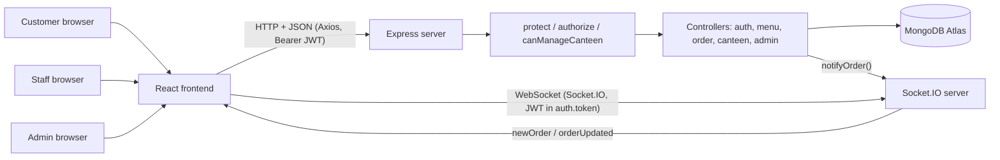
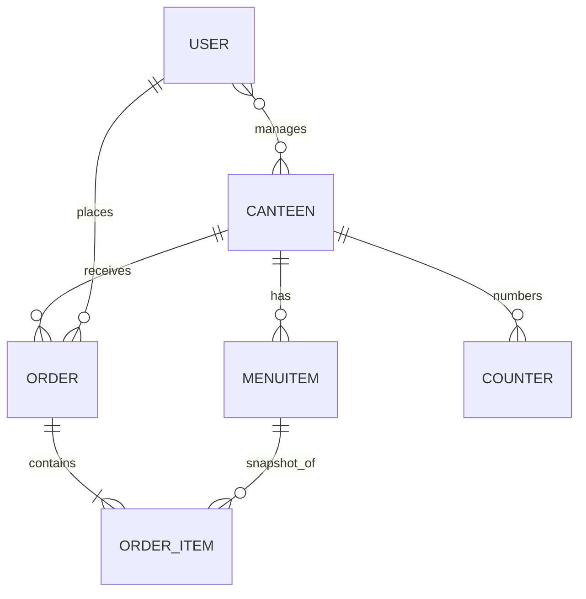
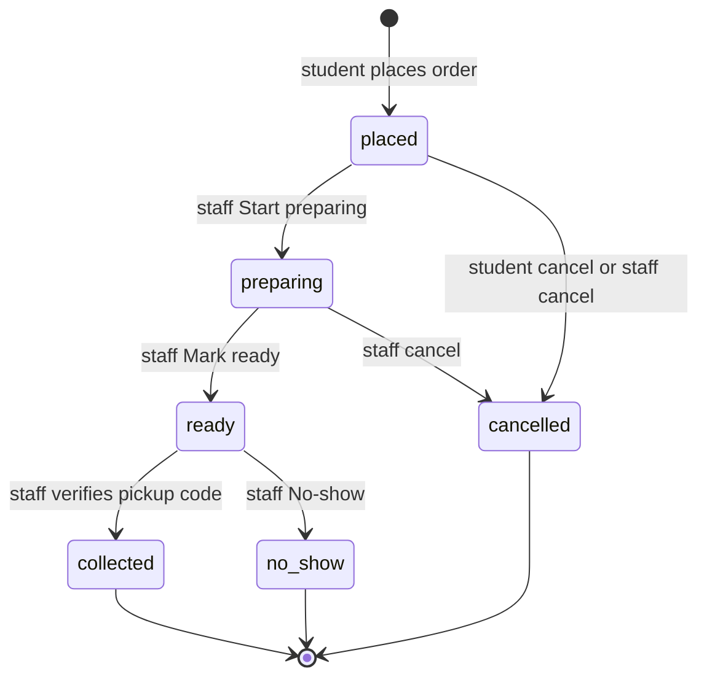

# canteen-management-system
Full-stack Canteen Management System using React, Node.js, Express and MongoDB
# CampusBites – College Canteen Pre-Order Platform

> Order from your campus canteen before you reach it. Skip the queue, collect at the counter, pay at the counter.

A MERN-stack (MongoDB, Express, React, Node.js) web app for **BBDU**, like a small "Swiggy inside the college" but **with no delivery** and **no online payment**. Students and teachers pick a canteen, choose food, choose a pickup time, then collect the food and pay cash or UPI at the counter.

**Status:** working version, under active development on branch `multi-canteen` (branch `main` is the finished single-canteen version). It runs locally; it is **not deployed yet**.

**How to read this file:** items marked **(unverified)** were not directly inspected when this README was written. Items under "Planned" are **not** built yet.

---

## Table of Contents

1. [Introduction](#1-introduction)
2. [Objectives](#2-objectives)
3. [Problem and Solution](#3-problem-and-solution)
4. [How to Use the Website](#4-how-to-use-the-website)
5. [Features in Detail](#5-features-in-detail)
6. [User Roles and Permissions](#6-user-roles-and-permissions)
7. [Technology Stack](#7-technology-stack)
8. [System Architecture](#8-system-architecture)
9. [Frontend](#9-frontend)
10. [Backend](#10-backend)
11. [Database](#11-database)
12. [Order Lifecycle](#12-order-lifecycle)
13. [API Reference](#13-api-reference)
14. [Live Updates: Socket.IO and Polling](#14-live-updates-socketio-and-polling)
15. [Authentication and Security](#15-authentication-and-security)
16. [Payments](#16-payments)
17. [Installation and Local Setup](#17-installation-and-local-setup)
18. [Environment Variables](#18-environment-variables)
19. [Folder Structure](#19-folder-structure)
20. [Testing and Debugging](#20-testing-and-debugging)
21. [Deployment](#21-deployment)
22. [Limitations and Roadmap](#22-limitations-and-roadmap)
23. [Glossary](#23-glossary)
24. [End-to-End Example](#24-end-to-end-example)
25. [Summary, Contributing, License](#25-summary-contributing-license)

---

## 1. Introduction

**The problem.** At a college canteen, everyone arrives at the same time (lunch break). Students stand in a long line, shout orders, the staff forget or mix up orders, and half the break is wasted.

**The idea.** Let people order from their phone *before* they arrive. The canteen sees the order on a screen, prepares it, and marks it ready. The student walks in, shows a 4-digit code, takes the food, and pays at the counter.

**Who uses it**
- **Students and teachers** – order food.
- **Canteen staff** – see and prepare orders on a dashboard.
- **Admin (the developer/college)** – creates canteens and staff logins and can view everything.

**Why better than the counter:** no shouting, no lost orders, prices always correct (the server calculates them), a pickup code prevents someone else taking your food, and each canteen only sees its own orders.

---

## 2. Objectives

| Objective | Status |
|---|---|
| Let students order food before arriving | Implemented |
| Support multiple canteens, each with its own menu and orders | Implemented |
| Let staff manage orders (prepare, ready, collect, cancel, no-show) | Implemented |
| Let customers see order status | Implemented (live via Socket.IO, with 30s polling fallback) |
| Pickup verification with a 4-digit code | Implemented |
| Cash/UPI payment confirmed manually at the counter | Implemented |
| Open/closed switch, pickup-slot limits, no-show auto-blocking | Planned (Days 12-14) |
| Order history, reorder, search, reports, PWA, deployment | Planned |

---

## 3. Problem and Solution

**Old way:** Riya reaches the canteen at 1:00 PM. 40 people are ahead of her. She waits 20 minutes, orders a sandwich, waits 10 more. Her break is over. The staff wrote 15 orders on paper and two got mixed up.

**New way:** At 12:40 Riya opens the app in class, picks the canteen, adds a sandwich, chooses pickup 1:00 PM. The canteen screen beeps with her order. By 1:00 PM it is marked Ready. Riya's phone shows "Ready" and her 4-digit code. She walks to the counter, says the code, pays, and leaves in one minute.

---

## 4. How to Use the Website

### As a student or teacher
1. Open the site and **Register** (name, email, phone, password), then **Login**.
2. The home page lists the **active canteens**. Tap one.
3. On the canteen menu, press **+** on items to add them to the cart. (One cart can only hold items from **one canteen**. If you add from another canteen you are asked whether to switch.)
4. Open **Cart**, choose a **pickup time**, and place the order. You can only have **one active order** at a time.
5. Go to **My Orders**. You see your order number (like `A7`), its status, and your **4-digit pickup code** while the order is active.
6. You can **cancel** only while the status is "placed".
7. When status becomes **Ready**, go to the counter, tell the staff the code, and pay cash/UPI.
8. Optionally press **Enable notifications** on My Orders so the browser can alert you when the order is ready.

### As canteen staff
1. Login with the account the admin created for your canteen.
2. Open **Dashboard**. Press **Enable sound** once (browsers block sound until you click), so new orders beep.
3. New orders appear automatically. Press **Start preparing**, then **Mark ready**.
4. When the student arrives, type their **pickup code**, keep **Payment received** ticked if they paid, and press **Collect**.
5. If a collected order was not paid yet, press **Confirm payment** later.
6. Use **Cancel** (placed/preparing orders) or **No-show** (ready orders) when needed.
7. Open **Manage Menu** to add, edit, delete items and mark items sold out.

### As admin
1. Login with your admin account (made with `makeAdmin.js`).
2. Open **/admin** to create canteens and create staff logins linked to canteens.
3. Use the **canteen switcher** on Dashboard/Manage Menu to view any canteen.

---

## 5. Features in Detail

### A. Customer features
| Feature | What happens behind the scenes | Where |
|---|---|---|
| Register / login | Password hashed with bcrypt, JWT returned and saved in `localStorage` | `authController`, `Login.jsx`, `Register.jsx`, `AuthContext.jsx` |
| Browse canteens | `GET /api/canteens` returns only active canteens | `CanteenList.jsx` |
| Browse a canteen menu | `GET /api/canteens/:id/menu` returns canteen and items | `CanteenMenu.jsx` |
| Cart for one canteen | Cart saved in browser (`localStorage` keys `cart`, `cartCanteen`); switching canteen prompts | `CartContext.jsx`, `Cart.jsx` |
| Place order | Server re-reads prices from the DB, creates order and pickup code | `orderController.createOrder` |
| Order number | `A1, A2...` per canteen per day (India time), using an atomic counter | `nextOrderNumber`, `Counter` model |
| See pickup code | Returned only for active orders and only to the owner | `getMyOrders`, `MyOrders.jsx` |
| Cancel order | Allowed only for the owner and only while `placed` | `cancelOrder` |
| Live status | Socket event triggers a refetch; 30s polling backup | `MyOrders.jsx` |
| Ready notification | Browser `Notification` API when status becomes `ready` and permission is granted | `MyOrders.jsx` |

### B. Staff features
| Feature | Where |
|---|---|
| See active orders of own canteen(s) (plus collected-but-unpaid) | `getActiveOrders`, `Dashboard.jsx` |
| Live new-order push with beep | `Dashboard.jsx`, `sound.js`, `socket.js` |
| Move order: placed → preparing → ready | `updateStatus` |
| Verify pickup code and collect | `verifyAndCollect` |
| Confirm payment separately | `confirmPayment` |
| Cancel (placed/preparing) or mark no-show (ready) | `updateStatus` |
| Call the student (phone link on card) | `Dashboard.jsx` |
| Manage menu (add/edit/delete/availability) | `ManageMenu.jsx`, `menuController` |
| Switch canteens (only if managing more than one) | `CanteenSwitcher.jsx`, `useStaffCanteen.js` |

### C. Admin features
| Feature | Where |
|---|---|
| Become admin via script | `server/makeAdmin.js` |
| Create canteens (`POST /api/canteens`), edit (`PATCH`) | `canteenController`, `AdminPanel.jsx` |
| Create staff login for canteen(s) | `POST /api/admin/staff` |
| Change which canteens a staff user manages | `PATCH /api/admin/users/:id/canteens` |
| View/manage every canteen | `canManageCanteen` returns true for admin |

### D. Data and safety features
- Server recalculates prices; order items store **snapshots** (name, price) so later menu changes do not alter old orders.
- Blocked users cannot order (the field exists; automatic blocking is planned for Day 14).
- Orders from before pickup codes existed (Day 8) have no code and can be collected without one (known legacy issue).

---

## 6. User Roles and Permissions

| Role | Can do | Pages | Restrictions |
|---|---|---|---|
| `student` / `teacher` | Browse, order, view own orders, cancel own `placed` order | `/`, `/canteen/:id`, `/cart`, `/orders` | Cannot open dashboard/admin; one active order at a time |
| `canteen` (staff) | Manage orders and menu of canteens in their `managedCanteens` | plus `/dashboard`, `/manage-menu` | Other canteens return 403; no `/admin` |
| `admin` | Everything, all canteens, create canteens and staff | plus `/admin` | None |

**Authentication** = checking *who you are* (login, JWT). **Authorization** = checking *what you may do* (roles and canteen ownership).

- Authentication: `protect` middleware reads `Authorization: Bearer <jwt>`, verifies it, then loads the user from the database on **every** request (so `managedCanteens` is always fresh).
- Authorization: `authorize(...roles)` checks the role; `canManageCanteen(user, canteenId)` is `true` for admin, and for staff only if the canteen is in their `managedCanteens`.
- Registration **never** sets a role. Only `makeAdmin.js` (run by the developer) or `POST /api/admin/staff` (admin) can create privileged accounts.

---

## 7. Technology Stack

| Technology | What it is | Where/why in this project |
|---|---|---|
| **React** (Vite, JSX) | UI library | All pages and components in `client/src` |
| **react-router-dom** | Page routing | Routes like `/dashboard`; `ProtectedRoute` guards them |
| **Axios** | HTTP client | `client/src/api.js` default instance with base URL `VITE_API_URL` and an interceptor that attaches the saved token |
| **Plain CSS** | Styling | `client/src/index.css` (classes `card`, `order-card`, `dash-grid`...) |
| **Node.js** | JS runtime | Runs the server |
| **Express** | Web framework | Routes, middleware, JSON API (`server.js`) |
| **MongoDB Atlas (M0)** | Cloud database | Stores users, canteens, menu items, orders, counters |
| **Mongoose** | MongoDB modelling | Schemas/models in `server/models` |
| **jsonwebtoken (JWT)** | Signed login tokens | Payload `{ id, role }` |
| **bcryptjs** | Password hashing | Passwords are stored as `passwordHash` |
| **dotenv** | Loads `.env` | Secrets and config |
| **cors** | Cross-origin rules | Allows the client URL(s) listed in `CLIENT_URL` |
| **Socket.IO** (server) and **socket.io-client** | Live two-way messages | New orders and status changes pushed instantly |
| **Web Audio API** | Browser sound | The new-order beep in `sound.js` |
| **Notification API** | Browser alerts | "Order ready" alert on My Orders |
| **nodemon** | Auto-restart in dev | `npm run dev` in `server/` |
| **crypto (Node built-in)** | Secure random | `crypto.randomInt` makes pickup codes |

No payment gateway, no Tailwind, and no validation library are used.

---

## 8. System Architecture



**Two channels, two jobs**
1. **HTTP (request/response):** the browser asks, the server answers once. Used for *all* real data and all changes (login, place order, change status).
2. **Socket.IO (server push):** a small "something changed" message pushed to the right people. The browser then calls HTTP again to fetch the fresh data. No order data or pickup code travels in the socket message.

**Polling** (a timer calling the API every 30s) still exists in Dashboard and My Orders as a safety net if the socket drops.

**What happens when you click "Mark ready":** React calls `api.patch('/orders/:id/status')` → Axios adds the token → Express runs `protect` → `authorize` → `updateStatus` checks ownership and allowed transition → saves to MongoDB → calls `notifyOrder` (socket push) → returns JSON → Dashboard reloads the list.

---

## 9. Frontend

**What it is:** the part running in the browser (React). It shows pages and talks to the server.

### Key files
| File | Responsibility |
|---|---|
| `App.jsx` | Route table, wraps pages in providers/layout |
| `api.js` | Axios instance (base URL from `VITE_API_URL`, adds `Authorization` header from `localStorage` token) and `errorMessage(err)` helper |
| `socket.js` | `connectSocket()` (reuses one connection, sends token in `auth`), `disconnectSocket()`. Socket URL = `VITE_API_URL` without trailing `/api` |
| `sound.js` | `enableSound()` (must be called from a click; resumes the AudioContext) and `beep()` (880 Hz tone, 0.5 s) |
| `useStaffCanteen.js` | Hook: loads the canteens a staff user may manage (admin: all), remembers the selected `canteenId` |
| `context/AuthContext.jsx` | Holds `user`, `loading`, `login`, `register`, `logout`; restores session from the saved token on page load; closes the socket when `user` becomes empty |
| `context/CartContext.jsx` | Cart items, the single cart canteen, `addItem(menuItem, canteen)`, saved in `localStorage` |
| `components/Layout.jsx`, `Navbar.jsx` | Page frame and navigation |
| `components/ProtectedRoute.jsx` | Redirects if not logged in / wrong role |
| `components/CanteenSwitcher.jsx` | Dropdown for staff/admin with several canteens |

### Pages
| Page | Route | What it does |
|---|---|---|
| `Login.jsx`, `Register.jsx` | `/login`, `/register` | Auth forms |
| `CanteenList.jsx` | `/` | Lists active canteens |
| `CanteenMenu.jsx` | `/canteen/:id` | Menu and add-to-cart |
| `Cart.jsx` | `/cart` | Shows "Ordering from X", pickup time, place order; disables ordering if the canteen is closed (UI only for now) |
| `MyOrders.jsx` | `/orders` | Current and past orders, pickup code, cancel, live updates, notification button |
| `Dashboard.jsx` | `/dashboard` | Staff order board |
| `ManageMenu.jsx` | `/manage-menu` | Staff menu editor |
| `AdminPanel.jsx` | `/admin` | Create canteens and staff logins |

`Menu.jsx` is an old unused file and can be deleted.

### React concepts as used here
- `useState` keeps data that changes (orders list, typed codes, `soundOn`).
- `useEffect` runs side effects: load data, start/stop timers, join/leave socket rooms (with cleanup functions).
- `useCallback` keeps `load` stable so effects do not re-run needlessly (Dashboard's `load` depends on `canteenId`).

### Dashboard functions (`Dashboard.jsx`)
- `load()` – `GET /orders?canteen=<id>` then `setOrders`; clears errors; sets `loading` false.
- Polling effect – resets the list, calls `load()`, then `setInterval(load, 30000)`; the timer is cleared on unmount or when the canteen changes.
- Socket effect – connects, joins `canteen:<id>`, rejoins after reconnect, on `newOrder` reloads and beeps, on `orderUpdated` reloads; on cleanup leaves the room and removes listeners (so switching canteens leaves the old room and joins the new one).
- `run(order, request)` – shared wrapper: disables buttons for that order, runs the request, reloads, shows errors.
- `setStatus(order, status, confirmText)` – asks for confirmation if given, then `PATCH /orders/:id/status`.
- `collect(order)` – requires a typed code, sends `PATCH /orders/:id/verify` with `{code, paid}` (`paid` is true unless the checkbox was unticked), then clears the typed code.
- `confirmPayment(order)` – `PATCH /orders/:id/payment`.

### My Orders functions (`MyOrders.jsx`)
- `load()` – `GET /orders/my`; active orders are those in placed/preparing/ready, the rest are past.
- Polling effect – every 30s (as edited in Day 11).
- Socket effect – on `orderUpdated`: reload, and if status is `ready` and notification permission is granted, show a browser notification.
- `cancel(id)` – confirm dialog, then `PATCH /orders/:id/cancel`.
- `OrderCard` – shows number, status pill, canteen name, pickup code box (active orders only).

---

## 10. Backend

**What it is:** the server that holds the rules and the database connection. Browsers can be tampered with, so *every* rule is enforced here.

**Startup (`server.js`):** loads `.env`, builds the Express app with `cors` (from `CLIENT_URL`, comma-separated) and `express.json()`, registers routes, adds a 404 handler and a central error handler, connects to MongoDB, then creates an HTTP server (`http.createServer(app)`), attaches Socket.IO with `initSocket(server)`, and listens on `PORT` (default 5001).

### Backend files
| File | Purpose |
|---|---|
| `server.js` | App setup, routes, DB connect, HTTP + Socket.IO start |
| `socket.js` | `initSocket`, `emitToUser`, `emitToCanteen`, `notifyOrder` |
| `middleware/auth.js` | `protect`, `authorize(...roles)`, `canManageCanteen(user, canteenId)` |
| `models/` | `User`, `Canteen`, `MenuItem`, `Order`, `Counter` |
| `controllers/` | `auth`, `menu`, `order`, `canteen`, `admin` |
| `routes/` | `authRoutes`, `menuRoutes`, `orderRoutes`, `canteenRoutes`, `adminRoutes` |
| `seed.js` | Adds 4 sample canteens and menus (Chhoti Canteen, Nescafe, Dominos, Burger Singh) without wiping existing data |
| `migrate-multi-canteen.js` | One-time migration: created CampusBites and attached old data |
| `makeAdmin.js` | `node makeAdmin.js email` – promotes a user to admin |

### `orderController.js` functions (verified)
| Function | What it does |
|---|---|
| `todayKey()` | Today's date in `Asia/Kolkata` so order numbers reset at midnight IST |
| `makePickupCode()` | 4-digit zero-padded code via `crypto.randomInt` |
| `publicOrder(order)` | Removes `pickupCode` and `codeAttempts` before sending to staff |
| `nextOrderNumber(canteenId)` | Atomic `findOneAndUpdate $inc` on `Counter` → `A<seq>` |
| `createOrder` | Checks: user not blocked; items array; valid pickup time (not >5 min in the past); each item has valid id and qty 1-20 (duplicates merged); no active order; all items exist, available, from one canteen; canteen active; recomputes prices; saves; `notifyOrder(order,'newOrder')`; returns 201 |
| `getMyOrders` | User's orders, newest first, canteen name populated; pickup code kept only for active orders |
| `getActiveOrders` | Staff: own canteens; admin: all or `?canteen=`; returns active orders plus collected-and-unpaid; no pickup code |
| `updateStatus` | Validates status and ownership; allowed moves only (see lifecycle); sets `readyAt` when ready; emits `orderUpdated`; rejects `collected` |
| `cancelOrder` | Owner only, only while `placed` |
| `verifyAndCollect` | Order must be `ready`; checks code (max 5 wrong tries then 429); sets `collected`; sets `paid` only if `paid === true`; emits |
| `confirmPayment` | For `ready` or `collected` orders → `paymentStatus: "paid"`; emits |

### `socket.js` functions (verified)
- `initSocket(server)` – creates the Socket.IO server with CORS from `CLIENT_URL`. A middleware verifies the JWT from `handshake.auth.token`, loads the user from the DB, and rejects with `No token` / `User not found` / `Invalid token`. On connect, the socket joins `user:<id>`. Events `joinCanteen` (validates the id and calls `canManageCanteen`; answers `{ok}`) and `leaveCanteen`.
- `emitToUser`, `emitToCanteen` – send an event to a room.
- `notifyOrder(order, event)` – sends `{orderId, orderNumber, status, paymentStatus, canteenId}` (never the pickup code). `newOrder` goes only to the canteen room; `orderUpdated` goes to the canteen room and the student's room.

> Internal details of `authController`, `menuController`, `canteenController`, `adminController` and `middleware/auth.js` were described from the project spec rather than re-read line by line **(unverified in this README)**.

---

## 11. Database

**MongoDB** stores data as *documents* (JSON-like) inside *collections* (like tables). **Mongoose** gives each collection a *schema* (allowed fields) and a *model* (the code object used to read/write). An **ObjectId** is the unique `_id` of a document. A **reference** stores another document's `_id`; **populate** swaps it for the real data when reading.

### Models
| Model | Stores | Fields |
|---|---|---|
| `Canteen` | A canteen | `name`, `slug` (unique), `logo`, `description`, `location`, `isOpen` (default true), `isActive` (default true), `slotLimit` (10), `avgPrepMins` (10), `createdAt` |
| `User` | Accounts | `name`, `email` (unique), `phone`, `passwordHash` (hidden by default), `role` (default student), `managedCanteens` [ref Canteen], `noShowCount` (0), `isBlocked` (false), `createdAt` |
| `MenuItem` | Food items | `canteen` (ref, required), `name`, `price`, `category`, `image`, `isAvailable` (true), `prepTimeMins` (10) |
| `Order` | Orders | `canteen` (ref, required), `orderNumber`, `user` (ref), `items` [{menuItem, name, price, qty}], `total`, `pickupTime`, `status`, `paymentStatus` (pending/paid), `pickupCode` (hidden), `codeAttempts` (hidden), `createdAt`, `readyAt` |
| `Counter` | Order-number counter | `_id` = `"<canteenId>:<YYYY-MM-DD>"`, `seq` |



### Example order document (fictional)
```json
{
  "_id": "665f0c1e2a9b4c0012ab34cd",
  "canteen": "665f0a112a9b4c0012ab0001",
  "orderNumber": "A7",
  "user": "665f0b772a9b4c0012ab0099",
  "items": [{ "menuItem": "665f0b002a9b4c0012ab0050", "name": "Veg Sandwich", "price": 40, "qty": 2 }],
  "total": 80,
  "pickupTime": "2026-10-30T07:30:00.000Z",
  "status": "placed",
  "paymentStatus": "pending"
}
```
(`pickupCode` is stored but never shown in normal staff responses.)

### What happens in the database
| Action | Reads | Writes |
|---|---|---|
| Register/login | Look up user by email | Register creates a `User` with hashed password |
| Place order | Active order check, menu items, canteen | `Counter` increment, new `Order` |
| Status change | The order | `status` (and `readyAt`) updated |
| Verify code | Order with `+pickupCode +codeAttempts` | `codeAttempts` on a wrong code; `status` (and maybe `paymentStatus`) on success |
| Confirm payment | The order | `paymentStatus = "paid"` |

---

## 12. Order Lifecycle



1. Student picks a canteen and items (cart stays with one canteen).
2. Student chooses a pickup time and presses order → `POST /api/orders`.
3. Server validates, recalculates prices, creates `A<n>` and a 4-digit code, saves, pushes `newOrder` to the canteen room.
4. Staff dashboard reloads and beeps.
5. Staff: **Start preparing** → `preparing`; **Mark ready** → `ready` (`readyAt` saved). Student gets a push and a browser notification (if allowed).
6. Student shows the code. Staff enters it → `PATCH /orders/:id/verify` → `collected`.
7. Payment: either ticked during Collect, or later through **Confirm payment**.

| Transition | Route / function |
|---|---|
| placed → preparing / cancelled, preparing → ready / cancelled, ready → no_show | `PATCH /orders/:id/status` → `updateStatus` |
| placed → cancelled (student) | `PATCH /orders/:id/cancel` → `cancelOrder` |
| ready → collected | `PATCH /orders/:id/verify` → `verifyAndCollect` |

**Status vs payment:** `status` says where the food is in the process; `paymentStatus` says whether money was received. They are independent. Collecting never marks paid automatically; staff must tick the box or confirm payment.

**Not built yet:** the automatic no-show after 20 minutes (Day 14). The manual No-show button currently sets only the status and does **not** add a strike.

---

## 13. API Reference

All responses are JSON. Errors look like `{ "message": "..." }`. Protected routes need `Authorization: Bearer <token>`.

| Method | Endpoint | Purpose | Auth / role |
|---|---|---|---|
| GET | `/api/health` | Health check | Public |
| POST | `/api/auth/register` | Create student/teacher account (fields unverified: likely name, email, phone, password) | Public |
| POST | `/api/auth/login` | Body `{email, password}` → token + user | Public |
| GET | `/api/auth/me` | Current user | Logged in |
| GET | `/api/canteens` | Active canteens | Public |
| GET | `/api/canteens/:id` | One canteen | Public (unverified) |
| GET | `/api/canteens/:id/menu` | `{canteen, items}` | Public (unverified) |
| POST | `/api/canteens` | Create canteen | Admin |
| PATCH | `/api/canteens/:id` | Edit canteen | Admin |
| GET | `/api/menu` | Menu items, optional `?canteen=<id>` | See code (unverified) |
| POST | `/api/menu` | Add item (canteen defaults to staff's only canteen, else must be sent) | Staff of that canteen / admin |
| PATCH/DELETE | `/api/menu/:id` | Edit/delete item (ownership checked) | Staff of that canteen / admin |
| POST | `/api/orders` | Place order. Body `{items:[{menuItemId, qty}], pickupTime}` | Logged in |
| GET | `/api/orders/my` | Own orders (code only for active) | Logged in |
| GET | `/api/orders` | Staff board; optional `?canteen=<id>` | Staff / admin |
| PATCH | `/api/orders/:id/status` | Body `{status}` | Staff of that canteen / admin |
| PATCH | `/api/orders/:id/verify` | Body `{code, paid?}` | Staff of that canteen / admin |
| PATCH | `/api/orders/:id/payment` | Mark paid | Staff of that canteen / admin |
| PATCH | `/api/orders/:id/cancel` | Cancel own `placed` order | Owner |
| POST | `/api/admin/staff` | Body `{name, email, phone, password, canteenIds[]}` creates a `canteen` user | Admin |
| PATCH | `/api/admin/users/:id/canteens` | Body `{canteenIds[]}` | Admin |

**Common errors:** 400 validation or invalid transition, 401 not logged in (unverified exact wording), 403 not allowed or blocked user or other canteen, 404 not found, 409 already has an active order, 429 too many wrong pickup codes.

**Example: place an order (fictional)**
```bash
curl -X POST http://localhost:5001/api/orders \
  -H "Authorization: Bearer <your-token>" \
  -H "Content-Type: application/json" \
  -d '{"items":[{"menuItemId":"665f0b002a9b4c0012ab0050","qty":2}],"pickupTime":"2026-10-30T07:30:00.000Z"}'
```
Response `201`: the order document (including `orderNumber`, `total`, `status: "placed"`).

---

## 14. Live Updates: Socket.IO and Polling

**Socket.IO** keeps an open connection so the server can push messages instantly. **Polling** means asking the server again and again on a timer.

**Actually implemented**
- Client: `connectSocket()` connects with `auth: { token }` after login; `disconnectSocket()` runs when the user becomes empty (logout).
- Server verifies the JWT on connection. Each user joins `user:<id>`. Staff/admin ask to join `canteen:<id>` with `joinCanteen`; the server checks `canManageCanteen`.
- Events (small payloads, no pickup code):

| Event | Sent to | When |
|---|---|---|
| `newOrder` | `canteen:<id>` | `createOrder` |
| `orderUpdated` | `canteen:<id>` and `user:<id>` | `updateStatus`, `cancelOrder`, `verifyAndCollect` (success), `confirmPayment` |

- The Dashboard listens for both, compares `payload.canteenId` with the selected canteen, then calls `load()`. `newOrder` also calls `beep()` (works after "Enable sound" was clicked).
- The Dashboard rejoins on `connect` after a drop. Switching canteen runs the effect cleanup: `leaveCanteen` for the old, `joinCanteen` for the new.
- My Orders listens for `orderUpdated`, reloads, and shows a browser notification when `ready`.
- **Polling fallback:** Dashboard and My Orders call `load` every **30 seconds** (`setInterval`, cleared on unmount/canteen change).

**Why both?** Sockets can drop (phone sleeps, bad Wi-Fi); polling guarantees the screen eventually catches up.

**Limitation:** browser notifications are reliable on desktop; on mobile Chrome they need a service worker (planned with the PWA work).

---

## 15. Authentication and Security

**Confirmed in code or spec**
- Passwords hashed with `bcryptjs`; `passwordHash` is `select: false` and never returned.
- JWT with payload `{ id, role }`; user reloaded from DB on every request.
- Role checks (`authorize`) and per-canteen checks (`canManageCanteen`) on staff endpoints.
- Ids validated with `mongoose.isValidObjectId`.
- Prices computed by the server; quantities limited to 1-20.
- Pickup code: secure random, hidden from staff and from non-active orders, 5 wrong attempts then 429.
- Socket connections require a valid JWT; room joins are ownership-checked.
- CORS limited to `CLIENT_URL` origins.
- Secrets live only in `.env`.

**Unverified:** token lifetime, how the client handles an expired token, exact registration validation.

**Recommended (planned Day 22):** `helmet`, `express-rate-limit` (especially on login), stricter input validation, route-by-route ownership audit.

**Known weaknesses:** the token is kept in `localStorage`; the closed-canteen rule is not enforced on the server yet; legacy orders without pickup codes.

---

## 16. Payments

- There is **no online payment and no payment gateway**, by design.
- Customers pay **cash or UPI at the counter**.
- `paymentStatus` is `pending` or `paid`. Staff set it by ticking **Payment received** when collecting, or later with **Confirm payment**.
- The check happens in the backend (`verifyAndCollect`, `confirmPayment`), but the "payment" is just staff recording what happened at the counter.

---

## 17. Installation and Local Setup

**Prerequisites:** Node.js (recent LTS), npm, Git, a free MongoDB Atlas cluster (M0).

```bash
git clone https://github.com/HarshitCode-02/canteen-management-system.git
cd canteen-management-system
git checkout multi-canteen
```
> If your repo root is a parent folder named `canteen-app`, run the commands below from there. The project has two apps: `server/` and `client/`, each with its own `package.json`.

**Backend** (`server/`)
```bash
cd server
npm install
# create .env (see next section)
node seed.js        # optional: sample canteens/menus
npm run dev         # nodemon server.js, expect "MongoDB connected" and "Server running on port 5001"
```
Make yourself admin (after registering on the site): `node makeAdmin.js your-email@example.com`, then log out and in again.

**Frontend** (`client/`)
```bash
cd client
npm install
# create .env with VITE_API_URL
npm run dev
```
Open the URL Vite prints and check `http://localhost:5001/api/health`.

---

## 18. Environment Variables

No `.env.example` file was confirmed in the repository. Create the files below yourself and **never commit them** (they hold secrets; `.env` must be in `.gitignore`).

| Variable | Required | Used by | Purpose | Placeholder |
|---|---|---|---|---|
| `MONGO_URI` | Yes (exact name unverified) | server | MongoDB Atlas connection string | `mongodb+srv://<user>:<password>@<cluster>/<db>` |
| `JWT_SECRET` | Yes (exact name unverified) | server `middleware/auth.js`, `socket.js` | Signs/verifies tokens | `<long-random-string>` |
| `CLIENT_URL` | Yes | server | Allowed origins for CORS and Socket.IO; comma-separated | `http://localhost:5173` |
| `PORT` | Optional | server | Server port (default 5001) | `5001` |
| `VITE_API_URL` | Yes | client `api.js`, `socket.js` | API base URL including `/api` | `http://localhost:5001/api` |

`server/.env` is loaded by `dotenv` (the server logs "injected env (4)", consistent with four variables).

---

## 19. Folder Structure

```
canteen-app/
├── server/
│   ├── models/        User, Canteen, MenuItem, Order, Counter
│   ├── controllers/   auth, menu, order, canteen, admin
│   ├── routes/        authRoutes, menuRoutes, orderRoutes, canteenRoutes, adminRoutes
│   ├── middleware/    auth.js
│   ├── server.js      app + HTTP + Socket.IO start
│   ├── socket.js      Socket.IO setup and emit helpers
│   ├── seed.js
│   ├── migrate-multi-canteen.js
│   ├── makeAdmin.js
│   └── .env           (never commit)
└── client/src/
    ├── App.jsx
    ├── api.js
    ├── socket.js
    ├── sound.js
    ├── useStaffCanteen.js
    ├── index.css
    ├── components/    Layout, Navbar, ProtectedRoute, CanteenSwitcher
    ├── context/       AuthContext, CartContext
    └── pages/         Login, Register, CanteenList, CanteenMenu, Cart,
                       MyOrders, Dashboard, ManageMenu, AdminPanel
```

---

## 20. Testing and Debugging

**There are no automated tests.** All testing so far is manual.

**Manual tests**
- Three roles: student, staff of Canteen A, staff of Canteen B, plus admin.
- Ownership: Dominos staff opening `GET /api/orders?canteen=<other id>` should get 403; staff cannot open `/admin`.
- Invalid status change (for example `placed → ready`) returns 400.
- Wrong pickup code 5 times returns 429.
- Socket check with a throwaway Node script (do not commit it); install `socket.io-client` temporarily in `server/` with `npm install --no-save socket.io-client`:
```js
const { io } = require('socket.io-client');
const s = io('http://localhost:5001', { auth: { token: process.env.TOKEN } });
s.on('connect', () => console.log('connected'));
s.on('connect_error', (e) => console.log('error:', e.message));
```
Run: `TOKEN="<your token>" node test.js` (a bad token should print `error: Invalid token`).
- Browser DevTools → Network tab shows API calls; → Application → Local Storage shows the saved `token`.

**Troubleshooting**
| Problem | Likely cause | Fix |
|---|---|---|
| `EADDRINUSE :::5001` | Old server still running | `lsof -i :5001`, then `kill <PID>` |
| No `MongoDB connected` | Wrong URI or Atlas IP not allowed | Check `.env` and Atlas Network Access |
| CORS error in browser | `CLIENT_URL` missing your client's origin | Add it (comma-separated), restart server |
| Socket error `Invalid token` | Not logged in or bad `JWT_SECRET` | Log in again, check env |
| No beep | Sound not enabled | Click **Enable sound** once |
| Blank page after edit | JSX syntax error (for example a duplicated `return (`) | Read the Vite terminal error |
| Grep/commands find no file | Wrong folder | `cd` into `server/` or `client/` |

---

## 21. Deployment

**Current state: local only. Nothing is deployed.** There is no `vercel.json` or CI configuration yet.

**Planned (Days 28-29):** MongoDB Atlas (database), Render (server, which supports WebSockets), Vercel (client, with a `vercel.json` rewrite so React Router pages work on refresh). In production set `CLIENT_URL` to the real Vercel URL, `VITE_API_URL` to the Render URL plus `/api`, use HTTPS, and keep secrets in each host's environment settings.

---

## 22. Limitations and Roadmap

**Known limitations**
- Closed-canteen rule is UI-only (server enforcement: Day 12).
- Orders from before Day 8 have no pickup code.
- Manual No-show does not count a strike; no automatic no-show yet.
- No automated tests.
- Staff cannot yet edit canteen details, reset an owner's password, or list owners (Days 20-21).

**Planned**
| Day | Feature |
|---|---|
| 12 | Open/closed switch, enforced in `createOrder` |
| 13 | Pickup slots with per-canteen limit |
| 14 | `node-cron` no-show job, strikes, auto-block, clear blocked message |
| 15-16 | Special instructions; order history and reorder |
| 17-18 | Images, search, filters, popular tags, rush meter, estimated wait |
| 19-20 | Sales reports; admin dashboard (owners, blocked users, disable canteen) |
| 21-23 | Password change/reset, PWA, security hardening, UI polish |
| 24-30 | Phone testing, real CampusBites menu, pilot, deployment, launch |

---

## 23. Glossary

| Term | Meaning (canteen example) |
|---|---|
| Frontend / Backend | What runs in your browser / what runs on the server |
| API / Endpoint | The server's menu of requests / one item on it, like `POST /api/orders` |
| HTTP request | A message from browser to server; **GET** reads, **POST** creates, **PATCH** changes part of something, **DELETE** removes |
| JSON | Text format for data, like `{"qty": 2}` |
| Status code | Number in the reply: 200 OK, 201 created, 400 bad request, 403 forbidden, 404 not found, 409 conflict, 429 too many tries |
| Component / State / Hook | A piece of UI / data a component remembers / a React function like `useState` |
| Middleware | Code that runs before a route, like checking the login token |
| Authentication / Authorization | Who are you? / What may you do? |
| JWT | A signed token the server gives you at login; you send it with every request |
| Hashing | One-way scrambling of passwords so the real password is never stored |
| Schema / Model | Rules for a document's fields / the code object that uses them |
| Collection / Document / ObjectId | Table-like group / one record / its unique id |
| Polling | Asking the server every few seconds |
| WebSocket / Socket.IO | A connection that stays open so the server can push news; Socket.IO is the library |
| Room | A Socket.IO group, like `canteen:123`, whose members get the same messages |
| Environment variable | A setting kept outside the code (secrets, URLs) |
| CORS | Browser rule about which websites may call your API |
| CRUD | Create, Read, Update, Delete |
| REST API | An API built around URLs and HTTP methods |
| Snapshot | A copy of name/price saved in the order so later menu changes do not alter it |

---

## 24. End-to-End Example

Riya (student) orders 2 sandwiches from Dominos. Staff member Karan works at Dominos.

1. **Login.** `Login.jsx` calls `AuthContext.login` → `POST /api/auth/login`. The token is saved in `localStorage`; `api.js` now attaches it to every request. `connectSocket()` opens a socket when a page needs it, sending the token.
2. **Browse.** `CanteenList.jsx` → `GET /api/canteens`. She taps Dominos; `CanteenMenu.jsx` → `GET /api/canteens/:id/menu`.
3. **Cart.** She presses **+** twice. `CartContext.addItem(menuItem, canteen)` stores the items and the canteen in React state and `localStorage`.
4. **Order.** In `Cart.jsx` she picks 1:00 PM and presses place order. Axios sends `POST /api/orders` with `{items, pickupTime}`.
5. **Server.** `protect` verifies the token and loads Riya. `createOrder` runs its checks, reads prices from MenuItem, calls `nextOrderNumber` (Counter increments → `A7`), saves the Order with a random code like `0427`, then calls `notifyOrder(order,'newOrder')` and returns 201.
6. **Staff screen.** Karan's Dashboard is in room `canteen:<dominos id>`. It receives `newOrder`, calls `load()` (`GET /api/orders?canteen=<id>`), the list re-renders, and the beep plays.
7. **Preparing / ready.** Karan presses **Start preparing**, then **Mark ready** → `PATCH /status`. `updateStatus` checks the allowed move, saves, emits `orderUpdated`.
8. **Riya's phone.** `MyOrders.jsx` gets `orderUpdated`, reloads `GET /orders/my`, shows "Ready" with her code, and shows a browser notification if she allowed it.
9. **Pickup.** She tells Karan `0427`. He types it, keeps **Payment received** ticked, presses **Collect** → `PATCH /verify`. `verifyAndCollect` compares the code, sets `collected` and `paymentStatus: "paid"`, emits `orderUpdated`.
10. **Done.** The order leaves Karan's board (collected and paid) and appears under Riya's past orders. If Karan had unticked the box, the order would stay on his board with **Confirm payment** until he presses it.

---

## 25. Summary, Contributing, License

**Summary.** CampusBites is a multi-canteen pre-order system with role-based access, per-canteen ownership, pickup-code verification, counter payments, and live updates, built as a solo B.Tech project.

**Skills shown:** REST API design, MongoDB modelling, JWT auth and role/ownership checks, atomic counters, WebSockets (Socket.IO rooms), React hooks and context, Git branching.

**Implementation status:** Days 1-11 of a 30-day plan are done and manually tested. See [Limitations and Roadmap](#22-limitations-and-roadmap).

**Contributing**
1. Create a branch: `git checkout -b feature/your-change`.
2. Make a small change, test it manually with at least two roles.
3. Commit with a clear message, push, and open a pull request against `multi-canteen`.
4. Never commit `.env` or real user data.

**License:** no license file has been identified in the repository.
